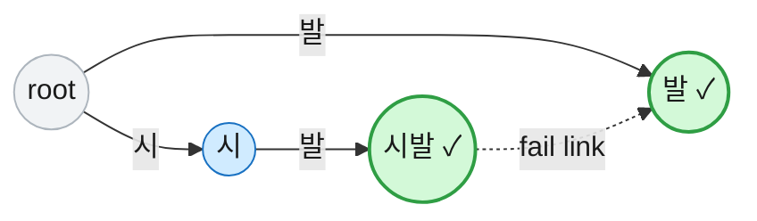
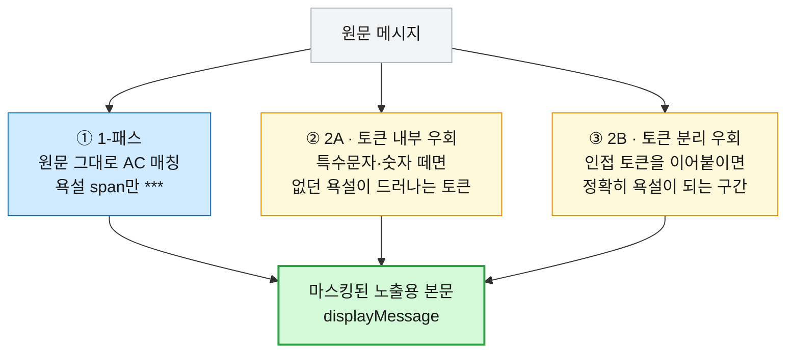

# [Aho-Corasick] 채팅 욕설 필터, 우회를 어떻게 잡을까 — 단순 Set·정규식과 비교

> ⚠️ 이 글은 채팅 욕설 필터의 **설계·구현 기록**입니다. 필터 알고리즘(Aho-Corasick + 전처리 3-스텝)과 그 테스트는 실제로 구현돼 있습니다. 다만 사전을 **어디서 불러오고 어떻게 갱신할지**(PostgreSQL → Redis 전파 → 인스턴스 메모리 trie의 3계층)는 설계까지 확정됐지만 로더는 아직 구현 전이라, 현재 기본값은 빈 사전입니다. "이렇게 만들었다"와 "이렇게 채우기로 설계했다"를 구분해 적었습니다.

## 1. 들어가며

채팅 욕설 필터를 처음 떠올리면 "욕설 목록을 만들어서 들어 있으면 가린다"로 끝날 것 같습니다. 막상 붙어 보면 정작 어려운 건 **단어를 아는 것**이 아니라 **우회를 잡는 것**입니다. 사용자는 필터를 피하려고 온갖 방법으로 글자를 비틉니다.

- **특수문자 삽입**: `시.발`, `시*발`
- **숫자 삽입**: `시1발`
- **토큰 분리**: `시 발` (공백으로 쪼갬)

이걸 다 막으려다 보면 반대쪽 함정에 빠집니다. **정상어를 깨뜨리는** 것입니다. 지명 `시발점`이나 문장 `구매 시 발송`은 그대로 둬야 하는데, 욕설을 잡겠다고 무리하면 멀쩡한 말까지 별표로 덮어 버립니다. 욕설 필터의 문제는 두 방향입니다. **우회는 끝까지 쫓아가 잡되, 정상어는 한 글자도 건드리지 않는 것.**

이 글은 그 두 마리 토끼를 잡으려고 **Aho-Corasick 알고리즘 + 전처리**를 택한 이유와, 단순 Set·정규식으로는 왜 부족했는지에 대한 기록입니다.

> 미리 밝혀 둘 게 있습니다. 아래 "이게 더 낫다"는 우리 서비스(짧은 채팅 메시지·수백 개 욕설 사전)라는 맥락에서 내린 판단이지 절대적인 우열이 아닙니다. 알고리즘이 하는 일(사실)과 제 결정은 최대한 구분해서 적었습니다.

## 2. 단순 Set과 정규식은 왜 부족했나

가장 먼저 떠오르는 두 방법부터 따져 봤습니다.

**단순 Set / contains**: 욕설을 `Set`에 담고 메시지에 들어 있는지 봅니다. 정확히 일치하는 욕설은 잡지만, 1장에서 본 우회는 전부 통과합니다. `시1발`은 사전의 `시발`과 글자가 다르니 `contains`로는 걸리지 않습니다. 우회를 막으려면 결국 `시1발`, `시.발`, `시*발`… 변형을 일일이 사전에 등록해야 하는데, 조합이 무한이라 손으로 감당이 안 됩니다.

**정규식(단어별 패턴)**: `시[^가-힣]*발` 같은 패턴으로 사이에 낀 문자를 흡수하면 일부 변형은 잡힙니다. 하지만 욕설이 수백 개면 패턴도 수백 개가 되고, 변형 규칙까지 곱해지면 유지보수가 지옥이 됩니다. 게다가 `.*`류가 얽힌 패턴은 입력에 따라 백트래킹으로 성능이 튀는 위험도 안고 갑니다.

세 방식을 비교하면 이렇습니다.

| 방식 | 잡는 것 | 못 잡는 것 / 문제 |
|---|---|---|
| **단순 Set / contains** | 정확히 일치하는 욕설 | 특수문자·숫자·공백 우회 전부 통과 |
| **정규식(단어별 패턴)** | 일부 변형 | 단어 N개 × 변형 → 패턴 폭발, 유지보수 부담, 백트래킹 성능 위험 |
| **Aho-Corasick + 전처리** (채택) | 다중 패턴 1회 스캔 + 전처리로 변형 우회 | 자모 분해(`ㅅㅂ`→`시 ㅂ ㅏ`)는 범위 밖 |

핵심은 문제를 두 갈래로 나눈 것이었습니다. **"어떤 욕설이든 한 번의 스캔으로 동시에 찾는" 부분**은 Aho-Corasick에, **"비틀어 놓은 걸 원래대로 되돌리는" 부분**은 전처리에 맡기기로 했습니다.

## 3. Aho-Corasick이 뭔가

Aho-Corasick(이하 AC)은 **여러 개의 패턴을 한 번의 좌→우 스캔으로 동시에 찾는** 문자열 매칭 알고리즘입니다. 욕설 사전이 수백 개일 때, 사전을 하나로 엮은 자료구조(trie)를 만들어 두고 메시지를 딱 한 번 훑으면서 걸리는 욕설을 전부 집어냅니다.

AC의 핵심 무기는 **실패 링크(failure link)** 입니다. 스캔하다 현재 글자로 더 못 내려가면, 처음으로 되돌아가 다시 시작하는 게 아니라 **"지금까지 읽은 글자의 접미(suffix)로 이어질 수 있는 다른 패턴"** 으로 건너뜁니다. 덕분에 겹치는 패턴까지 한 스캔에 잡힙니다. 예를 들어 사전에 `발`과 `시발`이 같이 있으면, `시발`을 읽는 도중 끝의 `발`도 함께 매칭됩니다.



우리 코드에서 이 오토마톤은 `AhoCorasick` 클래스가 담당합니다. 사전으로 trie를 한 번 빌드하고(`buildFailureLinks()`가 BFS로 실패 링크와 접미 패턴을 엮습니다), 그다음엔 검색만 합니다. 검색 메서드는 두 개입니다. 매칭된 **위치(span)** 를 전부 돌려주는 `findAll`, 하나라도 있으면 참을 주는 `containsAny`.

```java
/** text에 출현한 모든 패턴을 [start, endExclusive) 로 반환(겹침 포함). */
List<int[]> findAll(String text) { ... }
```

여기서 짚을 게 하나 있습니다. **AC의 점근적 성능 이득 자체는 우리한테 크지 않습니다.** 채팅 한 줄은 길어야 200자라, 사실 어떤 방식으로 훑어도 순식간입니다. 그런데도 AC를 쓴 이유는 성능이 아니라 **"다중 패턴 매칭의 정석 구조 + 위치(span) 반환"** 이 뒤에서 할 정밀 마스킹에 꼭 필요했기 때문입니다. 이 점은 실제 코드 주석에도 그대로 적어 뒀습니다: "입력 ≤200자라 점근 이득은 작지만 다중 패턴 정석 구조를 쓴다."

## 4. 핵심은 "전처리 + AC"의 조합

AC만으로는 `시1발` 같은 우회를 못 잡습니다. `시1발`은 글자 그대로는 사전의 `시발`이 아니니까요. 우리 필터(`ProfanityFilter.filter()`)는 우회의 종류를 **3-스텝**으로 나눠 처리합니다.



**① 1-패스: 원문 그대로 매칭.** 손대지 않은 원문을 AC로 훑어 욕설 span만 `***`로 가립니다. 위치를 알기 때문에 그 부분만 덮습니다. `시발!` → `***!` (뒤의 느낌표는 그대로).

**② 2A: 토큰 내부 우회.** 토큰에서 특수문자·숫자를 떼어낸(`stripNonLetters`) 결과가 **원문엔 없던 욕설을 새로 드러내면**, 그 토큰 전체를 `***`로 가립니다. `시1발` → 숫자를 떼면 `시발`이 되니 우회로 보고 `***`.

여기서 한 끗이 갈립니다. 단순히 "전처리하고 검사"하면 `시발!`처럼 구두점만 붙은 정상적인 경우까지 토큰 통째로 덮여 과하게 가려집니다. **전처리 후 욕설 수가 원문보다 늘었을 때만** 우회로 판정합니다.

```java
// 전처리(특수문자·숫자 제거)가 "원문보다 더 많은" 욕설을 드러냈을 때만 = 우회가 실제로 숨어 있던 경우.
// 욕설 수가 그대로면 단순 구두점일 뿐이라 1-패스가 부분 처리한다(예: "시발!" → "***!").
if (!stripped[i].equals(t)
        && profanity.findAll(asciiLower(stripped[i])).size()
            > profanity.findAll(asciiLower(t)).size()) {
    ranges.add(new int[]{tokens.get(i)[0], tokens.get(i)[1]});
}
```

`시1발`은 떼면 욕설이 0개→1개로 늘어 2A, `시발!`은 떼도 1개→1개라 2A가 아니라 1-패스가 부분 처리합니다. **개수 비교**라는 작은 장치 하나로 오버마스킹을 막았습니다.

**③ 2B: 토큰 분리 우회.** 인접한 2~K개 토큰을 전처리 후 이어붙인 게 정확히 욕설이면, 그 **윈도우 범위**를 `***`로 가립니다. `시 발` → 두 토큰을 붙이면 `시발`이라 그 구간을 통째로 `***`. 여기서 K는 사전에서 가장 긴 욕설의 길이(`maxWindow`)라, 그보다 넓은 조합은 아예 보지 않습니다.

## 5. 정상어는 어떻게 지키나 — 화이트리스트의 미묘함

우회를 열심히 잡을수록 정상어를 깨뜨릴 위험이 커집니다. `시발점`(지명)은 사전의 `시발`을 포함하니, 그냥 두면 `***점`이 돼 버립니다. 화이트리스트를 둡니다. `시발점`을 등록해 두면 마스킹에서 제외합니다.

그런데 화이트리스트를 "이 글자열이 들어 있으면 무조건 통과"로 만들면 구멍이 생깁니다. `시1발점`처럼 **일부러 숫자를 끼운 것도** 화이트리스트에 걸려 통과해 버립니다. 우리는 화이트리스트를 **1-패스의 리터럴 토큰에만** 적용합니다.

- `시발점`: 원문에 그대로 있는 정상어 → 1-패스에서 화이트리스트로 보호 → 보존.
- `시1발점`: 2A가 "숨은 욕설"로 먼저 판정 → 우회 토큰엔 화이트리스트를 적용하지 않음 → `***`.

화이트리스트는 **"원문에 그대로 있는 정상어만 통과"** 시키고, 비틀어 놓은 토큰엔 면죄부를 주지 않습니다. 코드에서도 화이트리스트 검사(`isWhitelisted`)는 1-패스의 `maskToken`에서만 부르고, 2A·2B에는 아예 넣지 않았습니다. 이게 단순 구현과 갈리는 지점입니다.

## 6. 정밀 마스킹 — 원문 가독성을 최대한 지킨다

흔한 구현은 욕설이 하나라도 나오면 **메시지 전체나 토큰 전체**를 가립니다. 간단하지만 정상어까지 손상되고, 다시보기나 로그에서 문맥이 사라집니다.

우리는 **우회가 일어난 토큰·윈도우 범위만** `***`로 덮고, 나머지 정상어와 공백은 그대로 둡니다. AC가 위치(span)를 주기 때문에 가능한 일입니다. 마스킹 문자는 길이와 무관하게 `***` 3글자 고정이라, 원문이 몇 글자였는지도 숨깁니다.

| 입력 | 결과 | 처리 |
|---|---|---|
| `시발!` | `***!` | 1-패스 부분 마스킹 |
| `시1발` | `***` | 2A 토큰 우회 |
| `시 발` | `***` | 2B 분리 우회 |
| `시발점이` | `시발점이` | 화이트리스트 보존 |
| `구매 시 발송` | `구매 시 발송` | 오탐 없음 |

마지막 두 줄이 이 필터가 목표한 지점입니다. **욕설은 별표로 덮되, 멀쩡한 말은 한 글자도 건드리지 않는 것.**

## 7. 왜 in-memory·동기인가

이 필터는 메시지가 올 때마다 **메모리에 올려 둔 trie로 동기 검사**합니다. Redis나 DB를 조회하지 않습니다. 채팅 전송은 WebFlux 리액티브 체인 위에서 도는데, 그 안에서 블로킹 I/O를 하면 이벤트 루프가 막힙니다(이 이야기는 WebFlux 글에서 다뤘습니다). 욕설 검사는 순수 CPU 연산이라 블로킹 없이 리액티브 체인 안에서 그대로 부를 수 있습니다.

실제 호출은 채팅 전송 파이프라인(`SendChatService`)의 저장 직전 단계에서 일어납니다. 원문은 `originalMessage`로, 마스킹본은 `displayMessage`로 **나눠서** MongoDB에 저장합니다. 노출은 마스킹본으로 하되, 원문은 신고·분쟁 대비로 남겨 둡니다.

필터는 **단어 집합만 주입받고 정규화만 소유**합니다. 사전을 어디서 가져오는지는 필터 바깥의 관심사로 분리했습니다. 설계상 사전은 3계층으로 흐릅니다 — **PostgreSQL(출처) → Redis로 변경 전파 → 각 인스턴스 메모리 trie**. 운영자가 단어를 바꾸면 DB에 반영하고, 그 변경을 Redis로 전 인스턴스에 알려 trie를 다시 빌드하는 그림입니다. 다만 앞서 밝혔듯 **이 로더는 아직 구현 전**이라, 지금은 설정값(CSV)으로 사전을 주입하고 기본값은 비어 있습니다. 필터 자체는 "단어 집합만 받으면 동작한다"로 만들어 뒀으니, 출처가 CSV든 DB든 필터 코드는 바뀌지 않습니다.

## 8. 솔직한 트레이드오프

이 필터가 다 막는 건 아닙니다. 숨기지 않고 적으면 이렇습니다.

**자모 분해 우회는 아직 못 잡습니다.** `ㅅㅂ`나 `시 ㅂ ㅏ`처럼 한글을 자모로 쪼갠 우회는, 음절을 다시 합성해야 판정할 수 있어 이번 버전 범위 밖입니다(코드 주석에도 명시). `ㅅㅂ`·`시ㅂ` 같은 흔한 변형형은 지금은 **사전에 리터럴로 등록**해서 대응하고, 일반적인 자모 합성은 과제로 남겼습니다.

전처리도 특수문자·숫자·공백까지입니다. leet(예: `a`→`@`) 치환이나 유니코드 정규화(NFC/NFD)는 넣지 않았습니다. 소문자화도 로케일 문제를 피하려고 ASCII(A–Z)만 처리합니다. `String.toLowerCase()`가 일부 문자에서 길이를 바꿔(예: `İ`→2글자) span 슬라이싱이 깨지는 걸 막기 위한 선택입니다.

AC의 점근 이득은 우리 입력 크기(≤200자)에선 작습니다. 앞서 말했듯 성능이 아니라 "정석 구조 + span 기반 정밀 마스킹"이 채택 이유입니다. 여기에 동기 CPU 비용도 정직하게 남는데, 사전이 아주 커지거나 트래픽이 폭증하면 별도 스케줄러로 오프로드하는 걸 열어 둔 과제로 두고 있습니다.

**지금 기본 사전은 비어 있습니다.** 알고리즘과 테스트(25개 케이스)는 돌지만, 운영 사전을 채우는 로더가 붙기 전까지는 실질적으로 통과 필터에 가깝습니다. 이 글은 "완성됐다"가 아니라 "이 구조로 만들었고, 사전 공급은 이렇게 채우기로 했다"까지입니다.

## 9. 정리

채팅 욕설 필터의 진짜 문제는 단어를 아는 것이 아니라, **우회는 끝까지 잡고 정상어는 지키는 것**이었습니다. 단순 Set은 우회에 무력했고, 정규식은 패턴이 폭발했습니다. 그래서 **"다중 패턴을 한 번에 찾는" 일은 Aho-Corasick에, "비튼 걸 되돌리는" 일은 전처리에** 나눠 맡겼습니다. 1-패스·2A·2B로 우회 종류를 분리하고, 개수 비교와 리터럴-한정 화이트리스트로 오버마스킹을 막고, AC가 주는 위치 정보로 딱 필요한 범위만 별표로 덮었습니다.

다시 말하지만 자모 분해 우회는 아직 못 잡고, 고급 정규화도 넣지 않았으며, 운영 사전을 채우는 로더는 구현 전입니다. AC의 점근 이득도 우리 입력에선 크지 않습니다. 그럼에도 "우회는 쫓되 정상어는 지킨다"는 목표에는 이 조합이 가장 잘 맞았다고 봤습니다.

### 📎 References

- [Aho & Corasick (1975), Efficient String Matching: An Aid to Bibliographic Search](https://dl.acm.org/doi/10.1145/360825.360855)
- [Aho–Corasick algorithm — Wikipedia](https://en.wikipedia.org/wiki/Aho%E2%80%93Corasick_algorithm)
- [Java `Character.isLetter(char)` — 유니코드 글자 판정](https://docs.oracle.com/en/java/javase/17/docs/api/java.base/java/lang/Character.html#isLetter(char))

